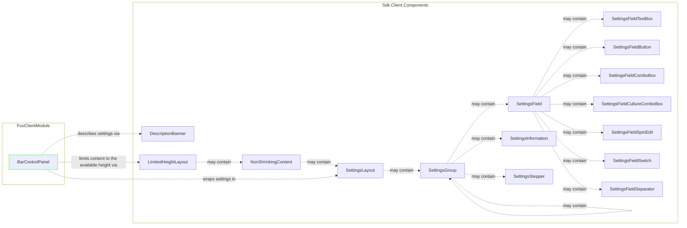

[[_TOC_]]

## Introduction

This document guides through the architecture and implementation of control panels.

It uses the term `FooClientModule` for an exemplary client module.

## Architecture

### Control panel components

```mermaid
flowchart TD
    subgraph "Sdk.Authorization"
        ModuleAuthorizeAttribute
    end

    subgraph SdkClientControlPanels["Sdk.Client.ControlPanels"]
        ControlPanelInfo

        subgraph Extensions
            AddControlPanel("AddControlPanel()")
            AddControlPanelCore("AddControlPanelCore()")

            AddControlPanel-. "calls [1]" .->AddControlPanelCore
            AddControlPanelCore-. "registers" .->IControlPanelRegistry
        end

        subgraph Attributes
           subgraph ControlPanelCategoryAttribute
              ControlPanelCategoryAttributeGenericParameter("CategoryDescriptorType")
           end

           subgraph ControlPanelGroupAttribute
              ControlPanelGroupAttributeGenericParameter("GroupDescriptorType")
           end

           subgraph ControlPanelChildAttribute
              ControlPanelChildAttributeGenericParameter("ParentDescriptorType")
           end

           subgraph ControlPanelParentAttribute
              ControlPanelParentAttributeGenericParameter("ParentDescriptorType")
           end
        end

        subgraph Services
            IControlPanelDescriptor
            IControlPanelState
            ControlPanelRegistryItem
            ControlPanelRegistry
            IControlPanelRegistry
            IControlPanelCategoryDescriptor
            IControlPanelGroupDescriptor
            IControlPanelParentDescriptor
            IControlPanelSaveHandler
            IControlPanelCancelHandler
            IControlPanelResetHandler
            AuthorizationRequirement
        end

        AddControlPanel-- "returns [2]" -->ControlPanelBuilder

        ControlPanelBuilder-.-WithAutoDiscovery["WithAutoDiscovery()"]
        ControlPanelBuilder-.-WithSaveHandler["WithSaveHandler()"]
        ControlPanelBuilder-.-WithCancelHandler["WithCancelHandler()"]
        ControlPanelBuilder-.-WithResetHandler["WithResetHandler()"]

        WithAutoDiscovery-- "determines" -->ComponentType
        WithAutoDiscovery-- "determines" -->StateType
        WithAutoDiscovery-- "determines" -->DescriptorType
        WithAutoDiscovery-- "determines" -->CategoryDescriptorType
        WithAutoDiscovery-- "determines" -->GroupDescriptorType
        WithAutoDiscovery-- "determines" -->ControlPanelInfoChildAttribute("ControlPanelChildAttribute")
        WithAutoDiscovery-- "determines" -->ControlPanelInfoParentAttribute("ControlPanelParentAttribute")
        WithAutoDiscovery-- "determines" -->ControlPanelInfoAuthorizeAttribute("ModuleAuthorizeAttribute")

        ComponentType-->ControlPanelInfo
        StateType-->ControlPanelInfo
        DescriptorType-->ControlPanelInfo
        CategoryDescriptorType-->ControlPanelInfo
        GroupDescriptorType-->ControlPanelInfo
        ControlPanelInfoChildAttribute-->ControlPanelInfo
        ControlPanelInfoParentAttribute-->ControlPanelInfo
        ControlPanelInfoAuthorizeAttribute-->ControlPanelInfo

        WithSaveHandler-- "registers" -->IControlPanelSaveHandler
        WithCancelHandler-- "registers" -->IControlPanelCancelHandler
        WithResetHandler-- "registers" -->IControlPanelResetHandler

        ControlPanelInfo-. "provides type to resolve" .->IControlPanelDescriptor
        ControlPanelInfo-. "provides type to resolve" .->IControlPanelState
        ControlPanelInfo-. "provides type to resolve" .->IControlPanelCategoryDescriptor
        ControlPanelInfo-. "provides type to resolve" .->IControlPanelGroupDescriptor
        ControlPanelInfo-. "provides the child and parent attributes' ParentDescriptorType to resolve" .->IControlPanelParentDescriptor
        ControlPanelInfo-. "provides attribute to build" .->AuthorizationRequirement

        IControlPanelDescriptor-- "passed to" -->ControlPanelRegistryItem
        IControlPanelState-- "passed to" -->ControlPanelRegistryItem
        IControlPanelCategoryDescriptor-- "passed to" -->ControlPanelRegistryItem
        IControlPanelGroupDescriptor-- "passed to" -->ControlPanelRegistryItem
        IControlPanelParentDescriptor-- "stored as-is on" -->ControlPanelRegistryItem

        ControlPanelRegistryItem-- "passed to" -->ControlPanelRegistry
        ControlPanelRegistry-- "implements" -->IControlPanelRegistry
    end

    subgraph FooClientModule
        BarControlPanel
        FooClientModuleServices["Services"]

        ConfigureServices("ConfigureServices()")
    end

    ConfigureServices-- "calls" -->AddControlPanel

    BarControlPanel-. "decorated with" .->ControlPanelCategoryAttribute
    BarControlPanel-. "decorated with" .->ControlPanelGroupAttribute
    BarControlPanel-. "decorated with" .->ModuleAuthorizeAttribute

    AuthorizationRequirement-- "passed to" -->ControlPanelRegistryItem

    classDef cluster fill:#ffffff10
    classDef authorization stroke:#ffff00
    classDef component stroke:#00ff00
    classDef controlPanelServices stroke:#ff00ff

    class ModuleAuthorizeAttribute,AuthorizationRequirement,ControlPanelInfoAuthorizeAttribute authorization;
    class BarControlPanel,ComponentType component;
    class FooClientModuleServices,StateType,DescriptorType,CategoryDescriptorType,GroupDescriptorType,IControlPanelDescriptor,IControlPanelState,IControlPanelCategoryDescriptor,IControlPanelGroupDescriptor,IControlPanelSaveHandler,IControlPanelCancelHandler,IControlPanelResetHandler,ControlPanelCategoryAttributeGenericParameter,ControlPanelGroupAttributeGenericParameter controlPanelServices;
```



### Settings components



## Implementation

### 1. Preamble

The following file structure in `FooClientModule` is assumed:

```
+ Foo.Client
  + Foo.Client.csproj
  + FooClientModule.cs
```
### 2. Add control panel state

- Add `BarControlPanelState.cs`

  ``` csharp
  using Sdk.Client.ControlPanels.Services;

  namespace Foo.Client;

  public sealed class BarControlPanelState : ControlPanelState
  {
  }
  ```
  > If you don't want to implement specific state then simply use [`ControlPanelState`](../src/Sdk.Client/ControlPanels/Services/ControlPanelState.cs) in the following steps instead of `BarControlPanelState`.

### 3. Add control panel

- Add `BarControlPanel.razor`

  ``` html
  @using Sdk.Client.ControlPanels.Components
  @using Sdk.Client.ControlPanels.Services

  @inherits ControlPanelBase<BarControlPanelState>

  @* content of control panel comes here *@
  ```

- Add code-behind file `BarControlPanel.razor.cs`

  ``` csharp
  namespace Foo.Client;

  public sealed partial class BarControlPanel : ControlPanelBase<BarControlPanelState>
  {
      // logic of the control panel comes here
  }
  ```
### 4. Add control panel content

> It is recommended to use component [`SettingsLayout`](../src/Sdk.Client/Components/Settings/SettingsLayout.razor.cs), [`SettingsGroup`](../src/Sdk.Client/Components/Settings/SettingsGroup.razor.cs), [`SettingsField`](../src/Sdk.Client/Components/Settings/SettingsField.razor.cs), [`SettingsFieldTextBox`](../src/Sdk.Client/Components/Settings/SettingsFieldTextBox.razor.cs), [`SettingsFieldButton`](../src/Sdk.Client/Components/Settings/SettingsFieldButton.razor.cs), [`SettingsFieldComboBox`](../src/Sdk.Client/Components/Settings/SettingsFieldComboBox.razor.cs), [`SettingsFieldCultureComboBox`](../src/Sdk.Client/Components/Settings/SettingsFieldCultureComboBox.razor.cs), [`SettingsFieldSpinEdit`](../src/Sdk.Client/Components/Settings/SettingsFieldSpinEdit.razor.cs), [`SettingsFieldSwitch`](../src/Sdk.Client/Components/Settings/SettingsFieldSwitch.razor.cs), [`SettingsFieldSeparator`](../src/Sdk.Client/Components/Settings/SettingsFieldSeparator.razor.cs), [`SettingsStepper`](../src/Sdk.Client/Components/Settings/SettingsStepper.razor.cs), [`SettingsInformation`](../src/Sdk.Client/Components/Settings/SettingsInformation.razor.cs), [`LimitedHeightLayout`](../src/Sdk.Client/Components/Settings/LimitedHeightLayout.razor.cs) and [`NonShrinkingContent`](../src/Sdk.Client/Components/Settings/NonShrinkingContent.razor.cs) to implement content in a unified way holding on to a unified user experience. See [architecture diagram](#settings-components) to understand how it all fits together.

- Add layout

  ``` html
  <SettingsLayout></SettingsLayout>
  ```

  > By default, `SettingsLayout` keeps 138 px free right of field contents, information texts, steppers and nested group expanders. This fits control panels and the settings dialog. Where horizontal space is limited, e.g. in a dialog, set `ContentPaddingRight` (in px) to reduce it: `<SettingsLayout ContentPaddingRight="16">`.

- Add settings group

  ``` html
  <SettingsLayout>
      <SettingsGroup Title="Connection" Subline="Connection settings" @bind-Expanded="State.ConnectionExpanded" @bind-Expanded:after="BeginEdit">
      </SettingsGroup>
  </SettingsLayout>
  ```

  > `Subline` and `Expanded` are optional parameters. In the preceding example `ConnectionExpanded` is a property of inherited parameter `State`. The property is [bound](https://learn.microsoft.com/en-us/aspnet/core/blazor/components/data-binding) to `Expanded` to provide the expanded state to the `SettingsGroup` component and receive the new state when the expander is clicked. This ensures that the expanded state is preserved across render cycles.

  > You may nest `SettingsGroup` in `SettingsGroup`. Deeper nesting is not supported.

  > `SettingsGroup` supports customizing the expander via property `Expander`. It is recommended to use [`ComboBoxExpander`](../src/Sdk.Client/Components/Settings/Expanders/ComboBoxExpander.razor.cs) or [`SwitchExpander`](../src/Sdk.Client/Components/Settings/Expanders/SwitchExpander.razor.cs).

  > It is recommended to use `@bind-...:after="BeginEdit"` alongside `@bind-...` statements to enter the "something has been edited" mode when the user changes settings. In this mode, the UI provides a `Save` and `Cancel` button to save or cancel user edits as a whole.

- Add settings field

  ``` html
  <SettingsLayout>
      <SettingsGroup Title="Connection" Subline="Connection settings" @bind-Expanded="State.ConnectionExpanded" @bind-Expanded:after="BeginEdit">
          <SettingsField Label="Name">
              <SettingsFieldTextBox Placeholder="Name" @bind-Value="@State.ConnectionName" @bind-Value:after="BeginEdit" />
          </SettingsField>

          <SettingsField>
              <SettingsFieldButton Text="Test connection" Busy="@State.TestConnectionRunning" OnClick="TestConnectionButtonClick" />
          </SettingsField>
      </SettingsGroup>
  </SettingsLayout>
  ```

  > Set `Busy` on [`SettingsFieldButton`](../src/Sdk.Client/Components/Settings/SettingsFieldButton.razor.cs) while the action behind it runs. The button keeps its place, size and text, shows that it is working and ignores further clicks, instead of the field replacing it with a spinner. `BusyIndication` selects the effect. Keep `Enabled` for a button that is unavailable: a button that is not enabled shows no busy state.

  > In the preceding example `ConnectionName` is a property of inherited parameter `State`. The property is [bound](https://learn.microsoft.com/en-us/aspnet/core/blazor/components/data-binding) to the input element to provide / receive the setting value and to preserve it across render cycles.

  > You can also use [`SettingsInformation`](../src/Sdk.Client/Components/Settings/SettingsInformation.razor.cs) instead of [`SettingsField`](../src/Sdk.Client/Components/Settings/SettingsField.razor.cs) to render a block of informational content.

  > You can use [`SettingsFieldSeparator`](../src/Sdk.Client/Components/Settings/SettingsFieldSeparator.razor.cs) between a set of [`SettingsField`](../src/Sdk.Client/Components/Settings/SettingsField.razor.cs) or other components to have a visual separation between the sets.

  > You can use [`SettingsStepper`](../src/Sdk.Client/Components/Settings/SettingsStepper.razor.cs) below a [`SettingsField`](../src/Sdk.Client/Components/Settings/SettingsField.razor.cs) to render a component with plus / minus buttons.

- Optional, wrap all content in [`LimitedHeightLayout`](../src/Sdk.Client/Components/Settings/LimitedHeightLayout.razor.cs) to keep it within the available height

  ``` html
  <LimitedHeightLayout>
      <div>
          Content that shrinks to fit the available height
      </div>
  </LimitedHeightLayout>
  ```

- Optional, wrap content that should not shrink in [`NonShrinkingContent`](../src/Sdk.Client/Components/Settings/NonShrinkingContent.razor.cs)

  ``` html
  <LimitedHeightLayout>
      <div>
          Content that shrinks to fit the available height
      </div>

      <NonShrinkingContent>
          <div>
              Content that does not shrink, keeps its full height
          </div>
      </NonShrinkingContent>
  </LimitedHeightLayout>
  ```

- Optional, add [`DescriptionBanner`](../src/Sdk.Client/Components/Settings/DescriptionBanner.razor.cs) to show a brief description for the control panel

  ``` html
  <DescriptionBanner Title="Lorem ipsum">
      Dolor sit amet
  </DescriptionBanner>

  @* content of control panel comes here *@
  ```

### 5. Add control panel descriptor

- Add `BarControlPanelDescriptor.cs`

  ``` csharp
  using Sdk.Client.ControlPanels.Services;
  using Sdk.Client.Modules;

  namespace Foo.Client;

  public sealed class BarControlPanelDescriptor : IControlPanelDescriptor<BarControlPanel>
  {
      public string Title => "General";
      public Uri IconUrl => ModuleAssetHelper.GetModuleIconUrl<FooClientModule>("icon.svg");
  }
  ```

### 6. Use or add control panel category descriptor

- Either use one of the predefined descriptors ...

  | Descriptor | Category
  |-|-|
  | [`IControlPanelNetworkCategoryDescriptor`](../src/Sdk.Client/ControlPanels/Services/IControlPanelNetworkCategoryDescriptor.cs) | `Network` |

- ... or add `BarControlPanelCategoryDescriptor.cs`

  ``` csharp
  using Sdk.Client.ControlPanels.Services;
  using Sdk.Client.Modules;

  namespace Foo.Client;

  public sealed class BarControlPanelCategoryDescriptor : IControlPanelCategoryDescriptor
  {
      public string Title => "Foo";
      public string? IconCssClass => null;
      public Uri? IconUrl => ModuleAssetHelper.GetModuleIconUrl<FooClientModule>("icon.svg");
      public int? Position => 3;
  }
  ```

### 7. Add control panel group descriptor (optional)

- Add `BarControlPanelGroupDescriptor.cs`

  ``` csharp
  using Sdk.Client.ControlPanels.Services;
  using Sdk.Client.Modules;

  namespace Foo.Client;

  public sealed class BarControlPanelGroupDescriptor : IControlPanelGroupDescriptor
  {
      public int Position => 3;
  }
  ```

### 8. Make control panel known

You can either [enable auto-discovery](#91-enable-auto-discovery) or manually register the control panel in a registry by [configuring visibility at runtime](#92-configure-visibility-at-runtime).

### 9. Configure control panel

Either [9.1](#91-enable-auto-discovery) or [9.2](#92-configure-visibility-at-runtime) is required to make the control panel known. The remaining sections are optional.

#### 9.1 Enable auto-discovery

- Define a control panel category with [`ControlPanelCategoryAttribute`](../src/Sdk.Client/ControlPanels/Attributes/ControlPanelCategoryAttribute.cs)

  ``` csharp
  using Sdk.Client.ControlPanels.Attributes;

  namespace Foo.Client;

  ...
  [ControlPanelCategory<BarControlPanelCategoryDescriptor>]
  public sealed partial class BarControlPanel ...
  {
      ...
  }
  ```

- Optionally define a control panel group with [`ControlPanelGroupAttribute`](../src/Sdk.Client/ControlPanels/Attributes/ControlPanelGroupAttribute.cs)

  ``` csharp
  using Sdk.Client.ControlPanels.Attributes;

  namespace Foo.Client;

  ...
  [ControlPanelGroup<BarControlPanelGroupDescriptor>]
  public sealed partial class BarControlPanel ...
  {
      ...
  }
  ```

- Add control panel

  ``` csharp
  using Sdk.Client.ControlPanels.Extensions;

  public sealed class FooClientModule : ClientModule
  {
      ...

      public override Action<IServiceCollection, HostingModel> ConfigureServices => (services, _) =>
      {
          services.AddControlPanel<FooClientModule, BarControlPanel, BarControlPanelState>()
              .WithAutoDiscovery<BarControlPanelDescriptor>();
      };
  }
  ```

  The extension method [`AddControlPanel<TClientModule, TControlPanel, TState>()`](../src/Sdk.Client/ControlPanels/Extensions/IServiceCollectionExtensions.cs#L24) registers the following core services:

  | Service type                                                                                                | Implementation type                                                                                       | Description                                        |
  |-------------------------------------------------------------------------------------------------------------|-----------------------------------------------------------------------------------------------------------|----------------------------------------------------|
  | [`IControlPanelRegistry<TClientModule>`](../src/Sdk.Client/ControlPanels/Services/IControlPanelRegistry.cs) | Created by [`IControlPanelRegistryFactory`](../src/Sdk.Client/ControlPanels/Services/IControlPanelRegistryFactory.cs) | Registry for all control panels of `TClientModule`, including children - see [9.5](#95-configure-a-parentchild-relationship) |

  The builder method [`WithAutoDiscovery<TDescriptor>()`](../src/Sdk.Client/ControlPanels/Builders/ControlPanelBuilder.cs#L19) registers the following scoped services:

  | Service type                                                                                                    | Implementation type         | Description                                                                                                                                                                            | Registered as [keyed service](../src/Sdk.Client/ControlPanels/ControlPanelServiceKey.cs) |
  |-----------------------------------------------------------------------------------------------------------------|-----------------------------|----------------------------------------------------------------------------------------------------------------------------------------------------------------------------------------|------------------------------------------------------------------------------------------|
  | [`IControlPanelDescriptor<TControlPanel>`](../src/Sdk.Client/ControlPanels/Services/IControlPanelDescriptor.cs) | `TDescriptor`               | Descriptor for the control panel                                                                                                                                                       | Yes                                                                                      |
  | `TState`                                                                                                        | `TState`                    | State for the control panel, implements [`IControlPanelState`](../src/Sdk.Client/ControlPanels/Services/IControlPanelState.cs)                                                         | Yes                                                                                      |
  | `TCategoryDescriptor`                                                                                           | `TCategoryDescriptor`       | Category for the control panel, `TCategoryDescriptor` is retrieved from [`ControlPanelCategoryAttribute`](../src/Sdk.Client/ControlPanels/Attributes/ControlPanelCategoryAttribute.cs) | No                                                                                       |
  | `TGroupDescriptor`                                                                                              | `TGroupDescriptor`          | Group for the control panel, `TGroupDescriptor` is retrieved from [`ControlPanelGroupAttribute`](../src/Sdk.Client/ControlPanels/Attributes/ControlPanelGroupAttribute.cs)             | No                                                                                       |

  > The control panel will be visible by default as it will be added to [`IControlPanelRegistry<TClientModule>`](../src/Sdk.Client/ControlPanels/Services/IControlPanelRegistry.cs) on resolve of the registry service type. See [architecture diagram](#control-panel-components) to understand how it all fits together.

  > As an alternative, control panels are allowed to be registered manually in the registry to [configure visibility at runtime](#92-configure-visibility-at-runtime).

#### 9.2 Configure visibility at runtime

- When [auto-discovery](#91-enable-auto-discovery) is **not** used, register core services

  ``` csharp
  using Sdk.Client.ControlPanels.Extensions;

  public sealed class FooClientModule : ClientModule
  {
      ...

      public override Action<IServiceCollection, HostingModel> ConfigureServices => (services, _) =>
      {
          services.AddControlPanelCore<FooClientModule>();
      };
  }
  ```

- Show control panel

  ``` csharp
  IControlPanelRegistry<FooClientModule> controlPanelRegistry = ...;

  controlPanelRegistry.Add<BarControlPanel, BarControlPanelState>(
      new BarControlPanelDescriptor(),
      new BarControlPanelState(),
      new BarControlPanelCategoryDescriptor(),
      new BarControlPanelGroupDescriptor());
  ```

- Hide control panel

  ``` csharp
  IControlPanelRegistry<FooClientModule> controlPanelRegistry = ...;

  controlPanelRegistry.Remove<BarControlPanel>();
  ```

> Additionally, the visibility can be controlled with features like authorization, see next section.

#### 9.3 Configure authorization

> Authorization affects the visibility of control panels at runtime. A control panel will not be visible when authorization fails.

- Provide authorization details

  ``` csharp
  ...
  [ModuleAuthorize<FooClientModule>(AccessLevel.Full)]
  public sealed partial class BarControlPanel
  {
      ...
  }
  ```

  ``` csharp
  IControlPanelRegistry<FooClientModule> controlPanelRegistry = ...;

  var moduleId = ModuleIdResolver.ResolveId<FooClientModule>();
  var authorizationRequirement = new AccessLevelAuthorizationRequirement(moduleId, AccessLevel.Full);

  controlPanelRegistry.Add<BarControlPanel, BarControlPanelState>(
      new BarControlPanelDescriptor(),
      new BarControlPanelState(),
      new BarControlPanelCategoryDescriptor(),
      new BarControlPanelGroupDescriptor(),
      authorizationRequirement);
  ```

#### 9.4 Configure save, cancel and reset handlers

All three handlers are optional. A control panel that only shows information needs none of them.

| Handler | Called when | Configure it when |
|---|---|---|
| `IControlPanelSaveHandler<TState>` | The user confirms the changes | The control panel calls `BeginEdit`. Without a save handler, confirming the changes fails with an error |
| `IControlPanelCancelHandler<TState>` | The user discards the changes | Discarding needs more than the reset that follows it, e.g. to release something the edit acquired |
| `IControlPanelResetHandler<TState>` | The control panel is shown, and after the changes were discarded | The state is loaded from somewhere, e.g. from a service |

- Configure handlers with a call to the associated `With` method provided by [`IControlPanelBuilder<TClientModule, TControlPanel, TState>`](../src/Sdk.Client/ControlPanels/Builders/IControlPanelBuilder.cs). The builder is returned by `AddControlPanel`, which is the only way to configure handlers. This also holds for a control panel whose [visibility is configured at runtime](#92-configure-visibility-at-runtime): call `AddControlPanel` for it and leave out `WithAutoDiscovery`.

  ``` csharp
  using Sdk.Client.ControlPanels.Extensions;

  public sealed class FooClientModule : ClientModule
  {
      ...

      public override Action<IServiceCollection, HostingModel> ConfigureServices => (services, _) =>
      {
          var controlPanelBuilder = services.AddControlPanel<FooClientModule, BarControlPanel, BarControlPanelState>();

          controlPanelBuilder.WithSaveHandler<BarControlPanelSaveHandler>();
      };
  }
  ```

- A handler belongs to the control panel it is configured for, not to the state type. It is registered as [keyed service](../src/Sdk.Client/ControlPanels/ControlPanelServiceKey.cs) of `TControlPanel`, so a control panel never uses the handlers of another control panel, even when both have the same `TState`.
- Control panels that share a state each configure their own handlers, and each handler covers only the part of the state its control panel shows. This applies in particular to the children of a parent control panel (see [9.5](#95-configure-a-parentchild-relationship)): a child that starts an edit needs its own save handler, and a child that loads its part of the state needs its own reset handler.

##### 9.4.1 Share handlers between control panels editing one entity

When a parent and its children edit one entity that is loaded and saved as a whole, e.g. a user and its roles, the parent
configures the handlers once with `WithSharedHandlers` and hands them to each child.

``` csharp
services.AddControlPanel<FooClientModule, BarControlPanel, BarControlPanelState>()
    .WithAutoDiscovery<BarControlPanelDescriptor>()
    .WithSharedHandlers(handlers => handlers
            .WithSaveHandler<BarControlPanelSaveHandler>()
            .WithResetHandler<BarControlPanelResetHandler>(),
        out var barControlPanelHandlers);

services.AddControlPanel<FooClientModule, BazControlPanel, BarControlPanelState>()
    .WithAutoDiscovery<BazControlPanelDescriptor>()
    .WithSharedHandlers(barControlPanelHandlers);
```

- Each control panel still has an edit of its own, and the suite saves, cancels and resets the running edits together. The
  control panels sharing a handler run it once for all of them, so a change on several tabs neither saves the entity twice
  nor, for a new one, creates it twice.
- The suite resets the control panels sharing a reset handler once when they are shown, so showing a tab does not discard
  the changes made on another. Share the reset handler with every one of them, so discarding a change made on any tab
  resets the entity.
- The handlers are registered as scoped [keyed services](../src/Sdk.Client/ControlPanels/ControlPanelServiceKey.cs) of the
  control panel calling `WithSharedHandlers` first, one instance shared by all control panels it hands them to. They get the
  state of whichever of these control panels runs them, so [share the state](#942-share-the-state-between-control-panels)
  as well and they get the same state whichever control panel runs them.
- The control panel calling `WithSharedHandlers` first cannot share a handler for an operation it has a handler of its own
  for, e.g. with `WithSaveHandler`; it would keep using its own one and the entity would be saved twice, so this throws an
  `InvalidOperationException`. A control panel the handlers are handed to keeps a handler it has configured already, which
  opts it out of sharing that operation.
- Control panels that configure the same handler types on their own share nothing.
- A scope edits one entity per owning control panel at a time.
- Control panels added with `IControlPanelRegistry.Add<>()` share handlers the same way, see
  [9.5.2](#952-parentchild-relationship-using-icontrolpanelregistryadd).

##### 9.4.2 Share the state between control panels

By default, every control panel has a state of its own, even when several have the same `TState`. When a parent and its
children work on one state, e.g. tabs showing parts of one entity, the parent shares its state with `WithSharedState` and
hands it to each child.

``` csharp
services.AddControlPanel<FooClientModule, BarControlPanel, BarControlPanelState>()
    .WithAutoDiscovery<BarControlPanelDescriptor>()
    .WithSharedState(out var barControlPanelState);

services.AddControlPanel<FooClientModule, BazControlPanel, BarControlPanelState>()
    .WithAutoDiscovery<BazControlPanelDescriptor>()
    .WithSharedState(barControlPanelState);
```

- All these control panels get the same state instance per scope, so a change made on one tab shows on the others.
- Sharing the state is independent of [sharing handlers](#941-share-handlers-between-control-panels-editing-one-entity):
  control panels can share their state but keep handlers of their own, share their handlers but keep states of their
  own, or share both.
- A control panel cannot be handed the state it shares itself, as resolving the state would never end; this throws an
  `InvalidOperationException`. For the same reason, do not hand two control panels each other's state.
- Control panels added with `IControlPanelRegistry.Add<>()` share a state by being added with the same instance, see
  [9.5.2](#952-parentchild-relationship-using-icontrolpanelregistryadd).

#### 9.5 Configure a parent–child relationship

A parent–child relationship gives structure to settings that belong to the same topic. The settings implemented in a child control panel are reached via a dedicated tab. The parent's own content is shown in the first tab, unless the parent only groups its children - see [9.5.4](#954-parent-without-content-of-its-own).

A control panel can be nested under another control panel it is a *child* of, to any depth. A control panel can be a child, a parent, both, or neither.

##### 9.5.1 Parent–child relationship using attributes

- Implement [`IControlPanelParentDescriptor`](../src/Sdk/Client/ControlPanels/Services/IControlPanelParentDescriptor.cs)

  ``` csharp
  using Sdk.Client.ControlPanels.Services;

  namespace Foo.Client;

  public sealed class BarControlPanelDescriptor : IControlPanelDescriptor<BarControlPanel>, IControlPanelParentDescriptor
  {
      ...
  }
  ```

- Self-declare the parent with [`ControlPanelParentAttribute<T>`](../src/Sdk.Client/ControlPanels/Attributes/ControlPanelParentAttribute.cs)

  ``` csharp
  using Sdk.Client.ControlPanels.Attributes;

  namespace Foo.Client;

  [ControlPanelCategory<BarControlPanelCategoryDescriptor>]
  [ControlPanelParent<BarControlPanelDescriptor>]
  public sealed partial class BarControlPanel : ControlPanelBase<BarControlPanelState>
  {
      ...
  }
  ```

- Self-declare the child with [`ControlPanelChildAttribute<T>`](../src/Sdk.Client/ControlPanels/Attributes/ControlPanelChildAttribute.cs), referencing the same `T`

  ``` csharp
  using Sdk.Client.ControlPanels.Attributes;

  namespace Foo.Client;

  [ControlPanelCategory<BarControlPanelCategoryDescriptor>]
  [ControlPanelChild<BarControlPanelDescriptor>]
  public sealed partial class BazControlPanel : ControlPanelBase<BazControlPanelState>
  {
      ...
  }
  ```

- Enable [auto-discovery](#91-enable-auto-discovery) for both control panels via `AddControlPanel<TClientModule, TControlPanel, TState>().WithAutoDiscovery<TDescriptor>()`

##### 9.5.2 Parent–child relationship using `IControlPanelRegistry.Add<>()`

As with [9.2](#92-configure-visibility-at-runtime), a control panel can be registered as a child at runtime - `Add()` takes the same descriptors via two optional parameters, `childOf` and `asParent`:

``` csharp
IControlPanelRegistry<FooClientModule> controlPanelRegistry = ...;

var barControlPanelDescriptor = new BarControlPanelDescriptor();

controlPanelRegistry.Add<BarControlPanel, BarControlPanelState>(
    barControlPanelDescriptor,
    new BarControlPanelState(),
    new BarControlPanelCategoryDescriptor(),
    asParent: barControlPanelDescriptor);

controlPanelRegistry.Add<BazControlPanel, BazControlPanelState>(
    new BazControlPanelDescriptor(),
    new BazControlPanelState(),
    new BarControlPanelCategoryDescriptor(),
    childOf: barControlPanelDescriptor);
```

When the parent and its children edit one entity, they can share their state and handlers as with auto-discovery (see [9.4.1](#941-share-handlers-between-control-panels-editing-one-entity) and [9.4.2](#942-share-the-state-between-control-panels)):

- The state is shared by adding the control panels with the same state instance. `WithSharedState` does not apply here, as it only changes the state auto-discovery resolves.
- The handlers are shared with `WithSharedHandlers`, without `WithAutoDiscovery`. Handlers are never part of the registry: the host resolves them from the services by the control panel type, however the control panel was added.

``` csharp
// ConfigureServices
services.AddControlPanelCore<FooClientModule>();

services.AddControlPanel<FooClientModule, BarControlPanel, BarControlPanelState>()
    .WithSharedHandlers(handlers => handlers
            .WithSaveHandler<BarControlPanelSaveHandler>()
            .WithResetHandler<BarControlPanelResetHandler>(),
        out var barControlPanelHandlers);

services.AddControlPanel<FooClientModule, BazControlPanel, BarControlPanelState>()
    .WithSharedHandlers(barControlPanelHandlers);

// At runtime
IControlPanelRegistry<FooClientModule> controlPanelRegistry = ...;

var barControlPanelDescriptor = new BarControlPanelDescriptor();
var barControlPanelState = new BarControlPanelState();

controlPanelRegistry.Add<BarControlPanel, BarControlPanelState>(
    barControlPanelDescriptor,
    barControlPanelState,
    new BarControlPanelCategoryDescriptor(),
    asParent: barControlPanelDescriptor);

controlPanelRegistry.Add<BazControlPanel, BarControlPanelState>(
    new BazControlPanelDescriptor(),
    barControlPanelState,
    new BarControlPanelCategoryDescriptor(),
    childOf: barControlPanelDescriptor);
```

- A child added at runtime to an auto-discovered parent gets the parent's state from the parent's registry item, e.g. `controlPanelRegistry.First(i => i.ComponentType == typeof(BarControlPanel)).State`.
- Handlers are keyed by the control panel type. When the same control panel type is added several times, e.g. once per network interface, all of them use the same handlers, so sharing handlers between them would join edits of different entities. Share handlers only between control panels of which each type is added once.

##### 9.5.3 Attach a child from a third-party module

A different module can declare a child of `BarControlPanel` by referencing only its public descriptor type - no dependency on `Foo.Client`'s control panel itself:

``` csharp
using Foo.Client;
using Sdk.Client.ControlPanels.Attributes;

namespace Qux.Client;

[ControlPanelCategory<QuxControlPanelCategoryDescriptor>]
[ControlPanelChild<BarControlPanelDescriptor>]
public sealed partial class QuxControlPanel : ControlPanelBase<QuxControlPanelState>
{
    ...
}
```

##### 9.5.4 Parent without content of its own

By default a parent is also the first page among its children, so its tab is labelled with the same `Title` the navigation uses. To give that page its own label, let the parent only group its children and move its content into a child:

- Set [`HasContent`](../src/Sdk.Client/ControlPanels/Services/IControlPanelDescriptor.cs) to `false` on the parent's descriptor

  ``` csharp
  public sealed class BarControlPanelDescriptor : IControlPanelDescriptor<BarControlPanel>, IControlPanelParentDescriptor
  {
      public string Title => "Bar";
      public Uri IconUrl => ...;
      public bool HasContent => false;
  }
  ```

- Add a child for the former content, hidden from navigation and placed first

  ``` csharp
  public sealed class BarGeneralControlPanelDescriptor : IControlPanelDescriptor<BarGeneralControlPanel>
  {
      public string Title => "General";
      public Uri? IconUrl => null;
      public int? Position => 0;
      public bool ShowInNavigation => false;
  }
  ```

Opening the parent shows its first child, ordered by `Position`, then `Title`. A control panel without content is not listed in navigation while it has no visible children.

## FAQ

### How to show a loading indication while executing tasks?

The loading indication can be controlled via [`IControlPanelState`](../src/Sdk.Client/ControlPanels/Services/IControlPanelState.cs).
An instance is passed to the control panel via Parameter `State`, which means that the required methods are directly available in the control panel.

``` csharp
namespace Foo.Client;

public sealed partial class BarControlPanel : ControlPanelBase<BarControlPanelState>
{
    private async Task OnExecuteOperation()
    {
        State.BeginLoading();
        try
        {
            // execute operation
        }
        finally
        {
            State.EndLoading();
        }
    }
}
```
